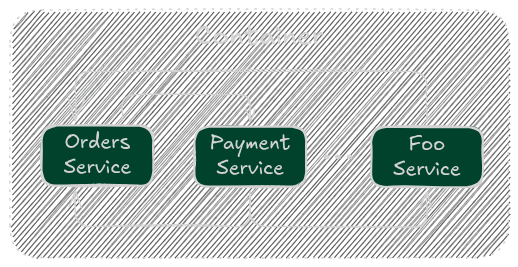

# Container

The **Container** in BeatleJS is responsible for storing and managing **service instances**. It acts as a **central hub** where all services are initialized, retrieved, and interacted with.

## How it works

When the application starts, **static services** are automatically initialized within the **container**'s constructor. **Dynamic services** are stored in the **global registries** but are not initialized until explicitly acquired using the provided methods in the Container.

The container enables **service-to-service communication**, meaning services can interact seamlessly without requiring **manual service initialization**.

<figure><figcaption></figcaption></figure>

It also plays a role in **plugin management**, allowing plugins to be registered and accessed dynamically.


While service **definitions** exist in the **global registry**, their **instances** are stored inside the container.


## **Why Use the Container?**

Using a container for **service instances** offers several benefits:

* **Prevents memory leaks** by ensuring controlled initialization and disposal.
* **Enhances modularity** by allowing dynamic service management.
* **Supports multiple containers**, enabling advanced configurations.


While BeatleJS allows multiple containers, it is generally best to use **one container per application** unless specific use cases require otherwise.


